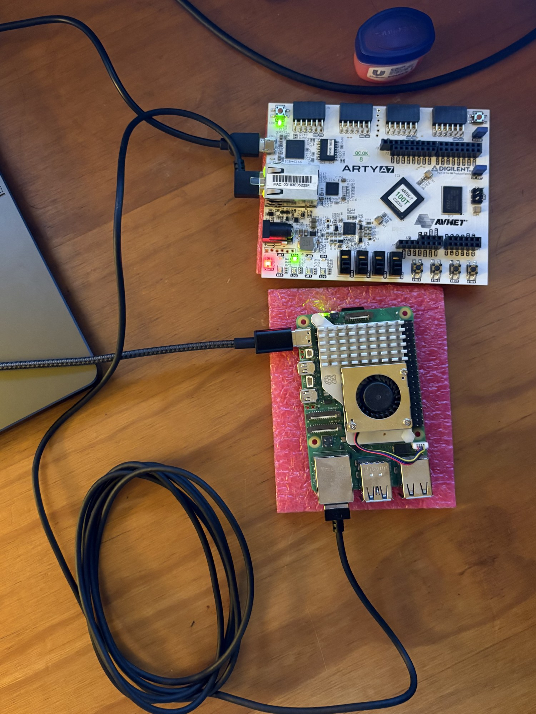
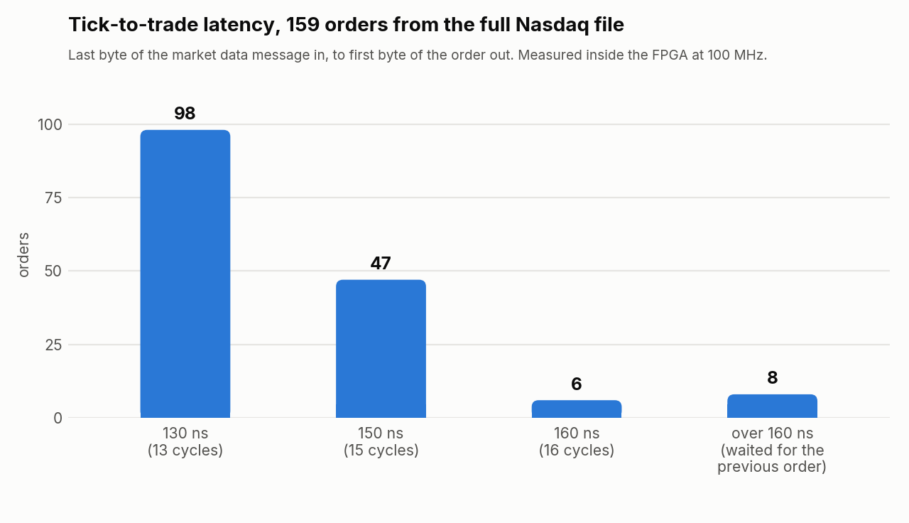
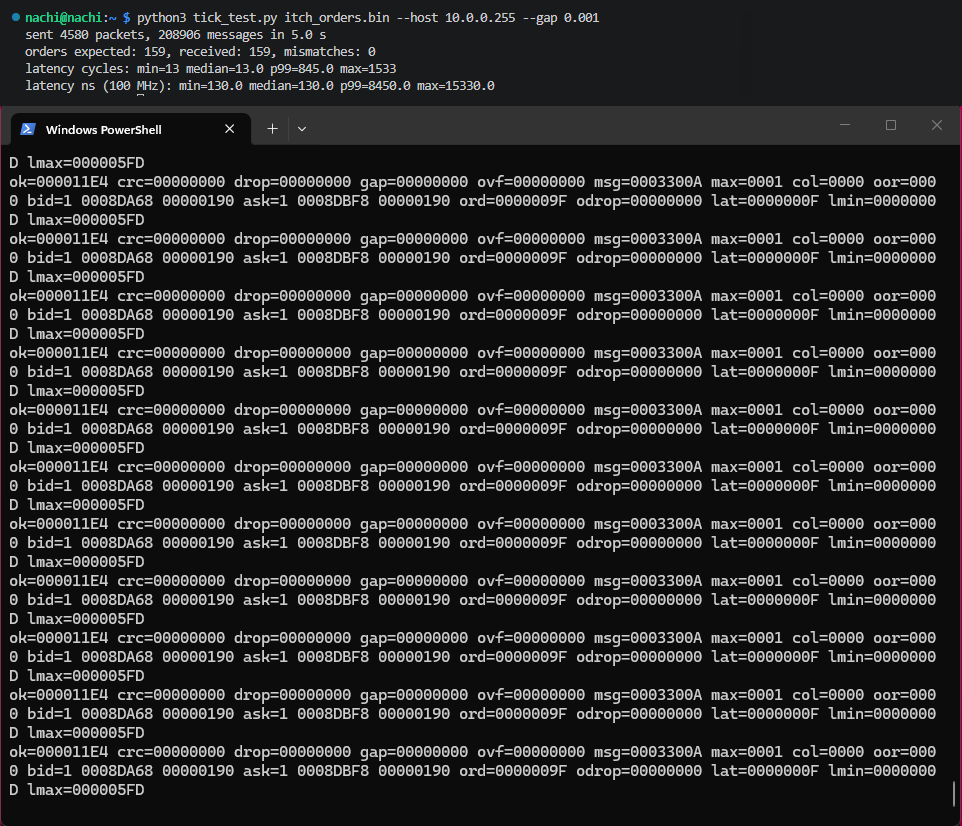
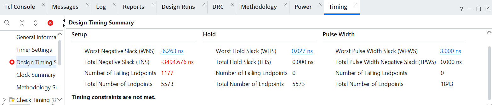
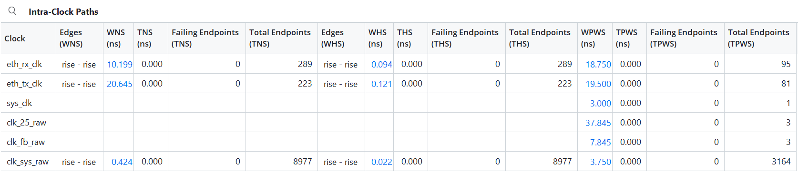

# FPGA tick-to-trade on an Arty A7

A small trading pipeline built in Verilog on a Digilent Arty A7-100T. The board receives real Nasdaq market data over Ethernet, keeps an order book for one stock, and sends an order back when the best ask price changes. From the last byte of market data in to the first byte of the order out takes 130 ns.

"Tick to trade" is the time between a market update arriving and your order leaving. Trading firms build this path in FPGAs because software cannot react in nanoseconds. I wanted to build the whole path myself, measure it on real hardware, and find out what limits it.



## Results

Measured on the board at 100 MHz, replaying 208,906 real Nasdaq ITCH messages from a Raspberry Pi 5.

| | |
|---|---|
| Orders sent | 159 of 159 match the Python model |
| Errors | 0 CRC errors, 0 lost packets, 0 buffer overflows, 0 dropped orders |
| Latency, minimum | 130 ns (13 clock cycles) |
| Latency, median | 130 ns |
| Latency, 99th percentile | 8.45 us |
| Latency, maximum | 15.33 us |
| Timing | Meets 100 MHz with 0.424 ns of slack |
| Size | 3,452 LUTs (5.4%), 3,243 flip-flops (2.6%), 26.5 block RAM tiles (19.6%), 2 DSP blocks |



151 of the 159 orders took 160 ns or less. The other 8 each arrived 1 to 4 messages after the previous order, so they had to wait for that order to finish sending. One order frame takes about 10 us on a 100 Mb/s link.

### Where the time goes

Latency is measured inside the FPGA. Every received byte is stamped with a clock cycle count, and each order packet carries its own latency number back to the Pi.

| Part | Time |
|---|---|
| FPGA logic: buffer, parser, order book, trigger, frame builder | 130 ns |
| Two clock crossings between the Ethernet chip's clocks and the system clock | 190 to 240 ns (from simulation) |
| Total at the board's pins for a typical order | about 320 to 370 ns |

The delay inside the Ethernet chip itself is not included. It cannot be seen from inside the FPGA.

## How it works

Data flows through these modules in order.

| Module | What it does |
|---|---|
| `mii_rx` | Takes 4-bit nibbles from the Ethernet chip, builds bytes, checks the frame CRC |
| `async_fifo` | Moves bytes from the Ethernet chip's 25 MHz clock to the 100 MHz system clock |
| `udp_strip` | Checks the Ethernet, IP and UDP headers, tracks MoldUDP64 sequence numbers, passes on the payload |
| `sync_fifo` | 4,096-byte buffer so the receiver never has to wait for the order book |
| `itch_parser` | Finds message boundaries and pulls out the fields of add, execute, cancel, delete and replace messages |
| `order_book` | Order table (1,024 sets of 4) and 4,096 price levels per side in block RAM. Tracks best bid and best ask |
| `trigger` | Fires a buy order when the best ask price changes and is at or below a limit |
| `order_tx` | Queues orders and builds the Ethernet, IP and UDP frame. The payload is modeled on the Nasdaq OUCH Enter Order message |
| `mii_tx` | Adds preamble and CRC and sends the frame to the Ethernet chip |
| `arty_t2t_top` | Board top: clocks, resets, pins, LEDs and a status line over UART once per second |

The design acts on a message before the frame's CRC has been checked. Waiting for the end of the frame would add far more delay than everything else combined, so bad frames are counted instead of blocked.

## How it was verified

The Python model in `scripts/book.py` is the reference. Every hardware result is compared against it.

- 35 cocotb tests in 11 suites, run with Icarus Verilog. Each module has its own suite, and two suites run the whole design with Ethernet frames on the pins.
- Real data in simulation: the full 200,000-message stream through the simulated Ethernet path, with every book update and every order checked.
- Real data on the board: the Pi replays the file, collects the orders that come back and compares each one with the model.
- The tests were checked too, by breaking the design on purpose and confirming a test fails each time.



## The 100 MHz problem

The first build at 100 MHz failed timing by 6.263 ns. The timing report showed the slow path: the order book turned a price into a price level with a divide by 100, and used the result as a memory address in the same clock cycle. That path had 30 levels of logic.

I ran the design at 50 MHz to get it working, then fixed the path. The divide became a multiply by a reciprocal spread over several cycles, and the memory read and write steps were split apart. The design now meets 100 MHz.





## Limits

- The 100 Mb/s Ethernet port is the biggest limit. A byte takes 80 ns to arrive and an order frame takes 10 us to send. The logic is already faster than the link.
- When the best price level empties, the order book looks for the next one level by level. The worst case is 4,095 clock cycles. The real data never came close, but the worst case is there.
- One stock at a time, in a price window of $40.96 around a base price.
- Orders go out as plain UDP. A real exchange connection is a TCP session with logins and acknowledgements.

## What is next

- A custom FPGA board with a faster Ethernet link, since the link is what holds this design back.
- A bitmap in the order book so finding the next price level takes a fixed two cycles.
- Removing idle cycles on the main path to get from 13 cycles down to about 8.

## Repository layout

| Folder | Contents |
|---|---|
| `rtl/` | The design |
| `board/` | Board top, UART status printer, pin and timing constraints |
| `tb/` | cocotb tests and Makefile |
| `scripts/` | Python model, replay and test scripts for the Pi, Vivado build script |
| `docs/` | Build log, screenshots, latency data |

## Running it

The market data is not in this repository. Nasdaq publishes sample ITCH 5.0 files. This project uses `12302019.NASDAQ_ITCH50`. Put it in `data/` and cut out the slice used here:

```
python3 scripts/extract.py data/12302019.NASDAQ_ITCH50 data/itch_orders.bin 200000 240000
```

### Simulation

Needs Icarus Verilog, cocotb and make.

```
cd tb
make TOP=parser
make TOP=book ITCH_FILE=../data/itch_orders.bin
make TOP=eth ITCH_FILE=../data/itch_orders.bin
make TOP=board
```

The other suites are `mii`, `udp`, `fifo`, `afifo`, `trigger`, `miitx` and `uart`.

### Build

Vivado 2026.1, free tier, no IP cores. From the repository root:

```
vivado -mode batch -source scripts/build.tcl
```

The bitstream and reports are written to `build/`.

### On the board

Connect a Raspberry Pi to the Arty with an Ethernet cable and give the Pi's port the address 10.0.0.1/24. Copy `scripts/` and `data/itch_orders.bin` to the Pi, program the board, press BTN0, then on the Pi:

```
python3 tick_test.py itch_orders.bin --host 10.0.0.255 --gap 0.001
```

It prints how many orders came back, how many match the model, and the latency numbers. The board also prints its counters over the USB serial port at 115200 baud.

## Build log

`docs/log.md` has the full history, stage by stage, with screenshots.
