# Build log

## 2026-11-15: Stage 4 on the board, tick to trade

- Back to 100 MHz. The price to price-level conversion in `rtl/order_book.v` no longer divides in one clock cycle. It multiplies by a reciprocal over several cycles, and the memory read and write steps are split up. Timing passes at 100 MHz with 0.424 ns of slack.
- Added the trigger (`rtl/trigger.v`): when the best ask price changes and is at or below a limit price, buy at that price.
- Added the transmit path: a 16-entry order queue and frame builder (`rtl/order_tx.v`) and an MII transmitter (`rtl/mii_tx.v`). Each order goes out as a UDP packet with a payload modeled on the Nasdaq OUCH Enter Order message.
- Latency is measured inside the FPGA. Every received byte is stamped with a clock cycle count. Latency is the time from the last byte of the message that caused the trigger to the first byte of the order frame, and each order packet carries its own number.
- `scripts/tick_test.py` on the Pi replays the file, collects the orders that come back and checks them against the Python model (`scripts/strategy.py`).
- 20,000 messages: 10 of 10 orders match the model.
- Full file, 208,906 messages: 159 of 159 orders match. 0 dropped orders, 0 CRC errors, 0 sequence gaps, 0 buffer overflows.
- Latency over the 159 orders: minimum 130 ns, median 130 ns, 99th percentile 8.45 us, maximum 15.33 us. 151 orders took 160 ns or less.
- The 8 slow orders each came 1 to 4 messages after the previous order. They waited in the queue because one order frame takes about 10 us to send on a 100 Mb/s link.
- At the board's pins the figure is the counter value plus 190 to 240 ns for the two clock crossings (from simulation), so about 320 to 370 ns for a typical order. The delay inside the Ethernet chip is not included.
- Size on the chip: 3,452 LUTs (5.4%), 3,243 flip-flops (2.6%), 26.5 block RAM tiles (19.6%) and 2 DSP blocks.

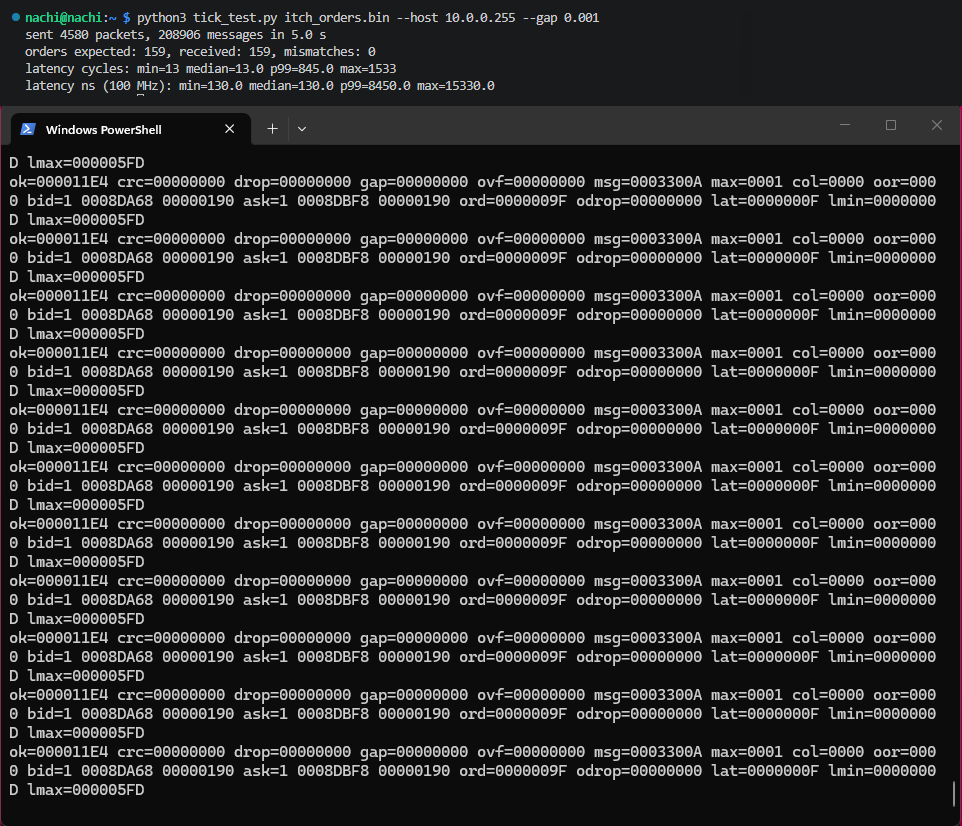

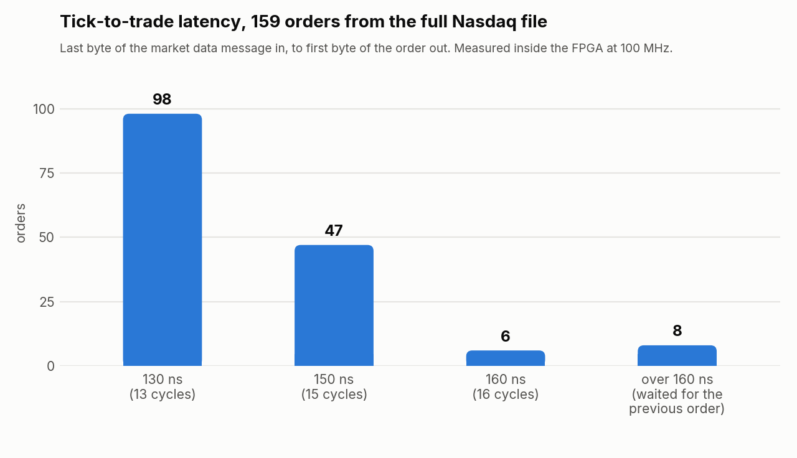

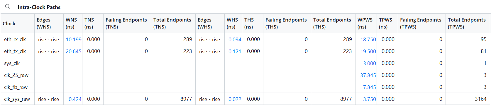

Raw latency data: `latency.csv`

## 2026-11-13: Stage 3 on the board

- Wrote the board wrapper `board/arty_t2t_top.v`. It gives the Ethernet chip its 25 MHz clock and reset, moves received bytes from the chip's clock to the system clock (`rtl/async_fifo.v`), and prints the counters and best bid and ask over UART once per second (`board/status_uart.v`).
- First build at 100 MHz failed timing. Worst negative slack was -6.263 ns with 1,177 failing endpoints, all on the system clock. The slowest path takes about 16.3 ns, so the design tops out near 61 MHz. The system clock is 50 MHz for now. Speeding up the slow path is a later task.
- The 50 MHz build meets timing with 0.315 ns of slack. The slowest path goes from the parser's price register, through the price to price-level conversion (a divide by 100), to the read address of the price-level memory: 30 logic levels and 18.8 ns.
- Size on the chip: 3,452 LUTs (5.4%), 1,772 flip-flops (1.4%), 21.5 block RAM tiles (15.9%) and 2 DSP blocks. Full report in `utilization_report.txt`.
- A Raspberry Pi 5 sends the Nasdaq file to the board as MoldUDP64 over UDP (`scripts/replay.py`) through a direct Ethernet cable.
- 20,000 messages: the board received 524 of 524 packets. Best bid 1,744 at $57.92, best ask 1,454 at $57.98 for UN. Matches `scripts/expected.py`.
- Full file, 208,906 messages in 4,580 packets: best bid 400 at $58.02, best ask 400 at $58.06. Matches the Python model. 0 CRC errors, 0 sequence gaps, 0 buffer overflows, 0 dropped frames.

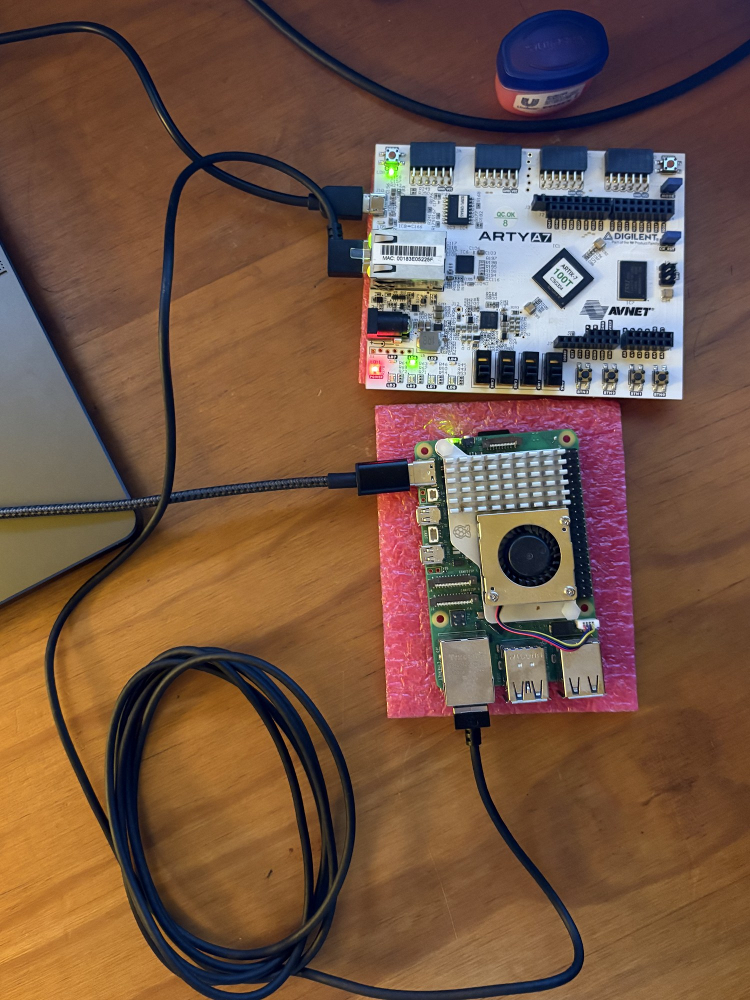

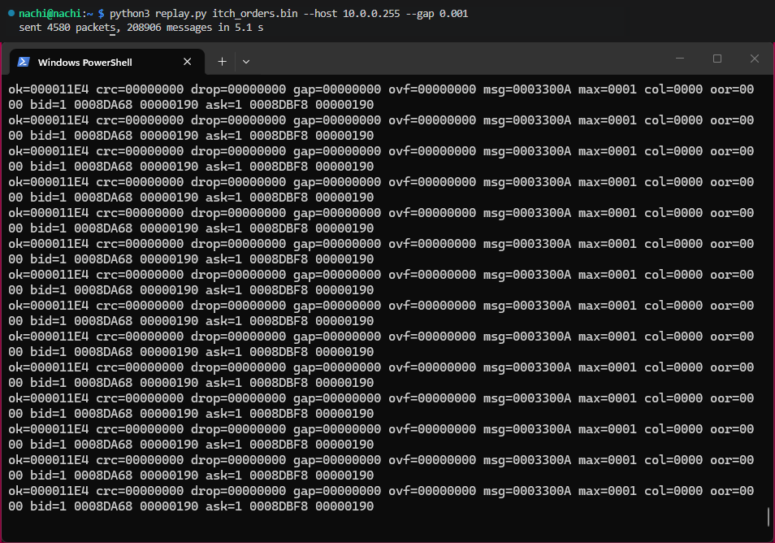

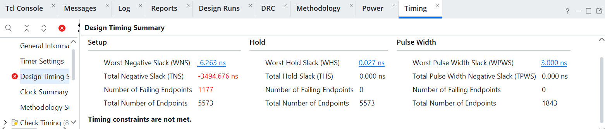

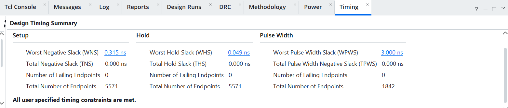

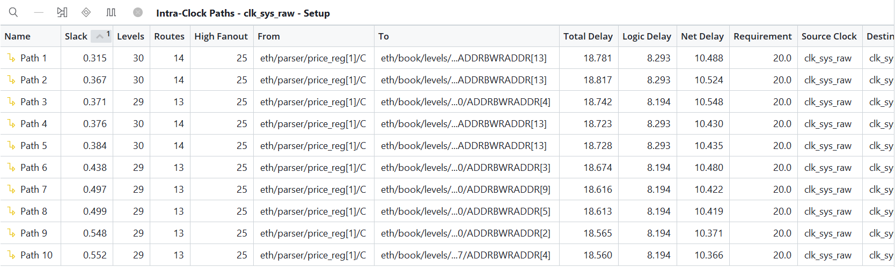

## 2026-11-13: Board bring-up

- Installed Vivado 2026.1 with the free Basic tier license.
- Created the Vivado project for the Arty A7-100T (part `xc7a100tcsg324-1`).
- Built and loaded `board/blink.v`. The 4 green LEDs (LD4 to LD7) count in binary and LD4 blinks once per second.
- This proves the tools, the USB cable and the board all work.
- Built and loaded `board/uart_hello.v`. The board sends "Hello from Arty" to the laptop once per second over the USB cable at 115200 baud.

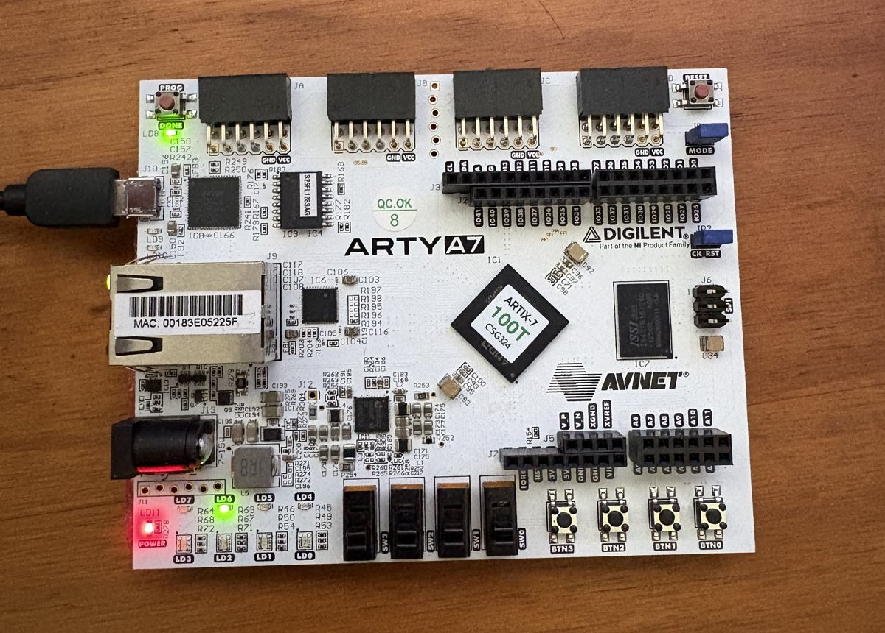

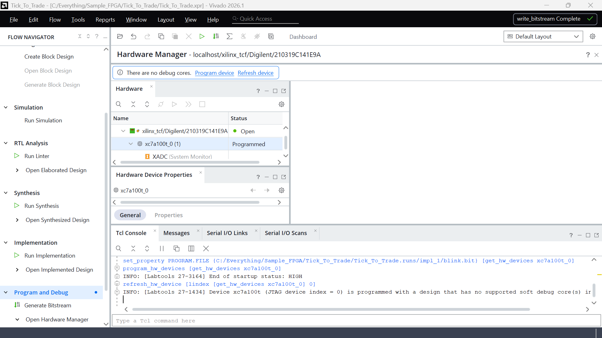

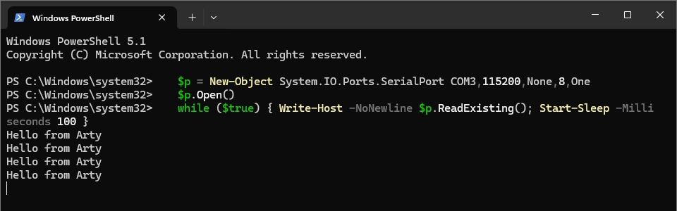

## 2026-11-12: Review and Stage 3 in simulation

- Order book memories moved to a block RAM pattern (`ram_sdp.v`). A trial synthesis now maps them to block RAM.
- Added the Ethernet receive path in simulation: `mii_rx`, `crc32`, `udp_strip`, `sync_fifo` and `t2t_eth_top`.
- 200,000 real Nasdaq messages sent through the simulated Ethernet path. All 9,187 book updates match `book.py`.
- Known limit: two full price searches back to back fill the 4,096-byte buffer to 3,809.

## 2026-11-07: Stages 1 and 2 in simulation

- ITCH 5.0 parser passes 100,000 real Nasdaq messages with zero mismatches, with and without gaps between bytes.
- Order book matches the Python model on 35,008 real book updates across 5 stocks.

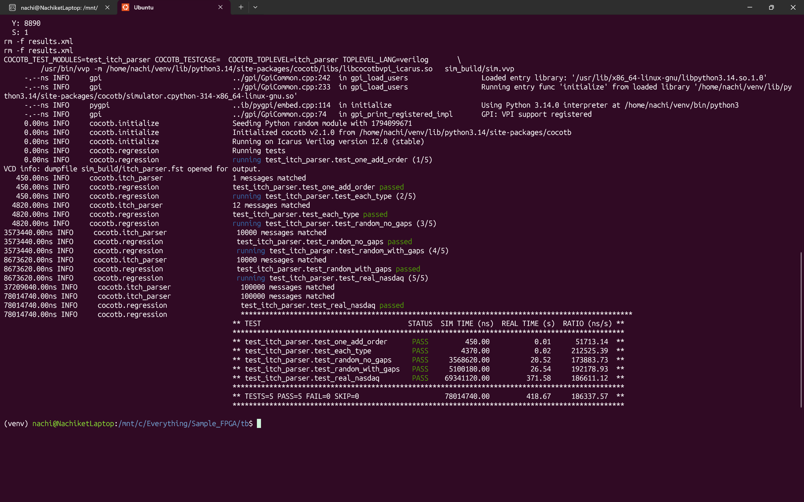

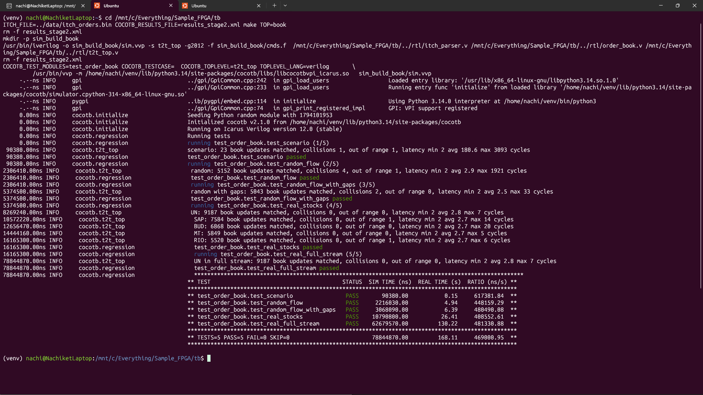

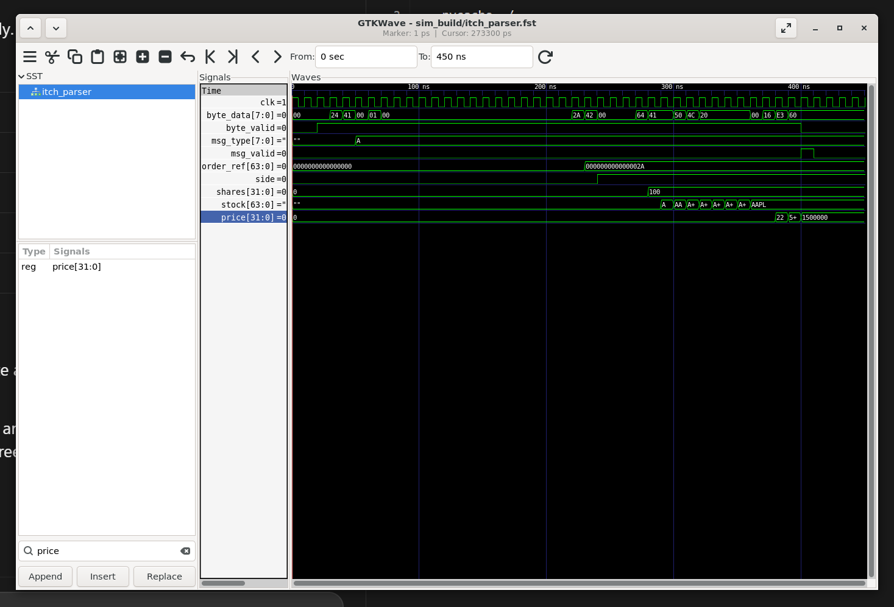
